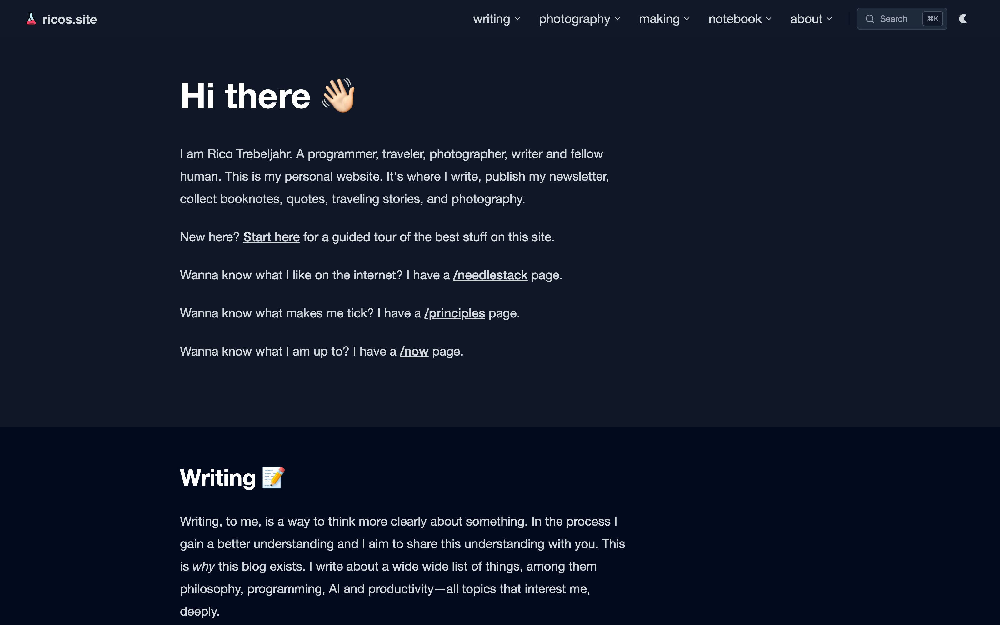
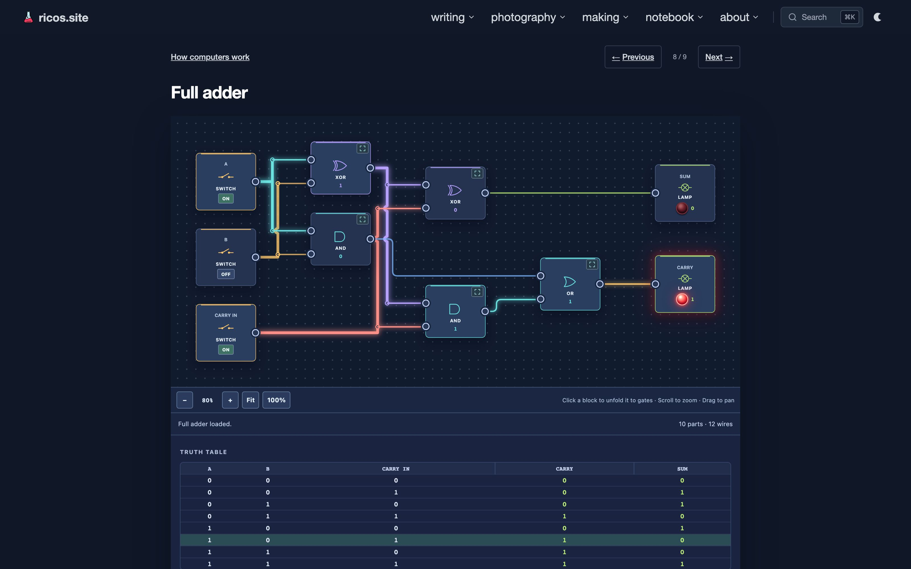
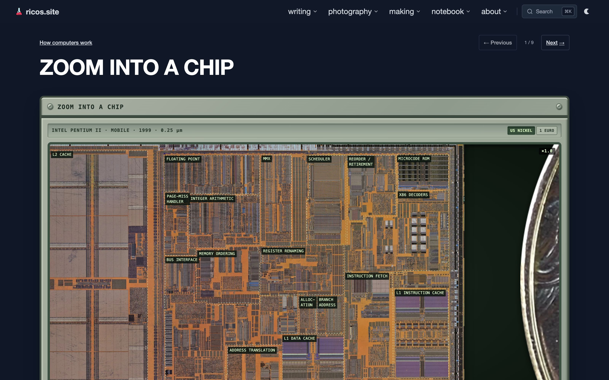
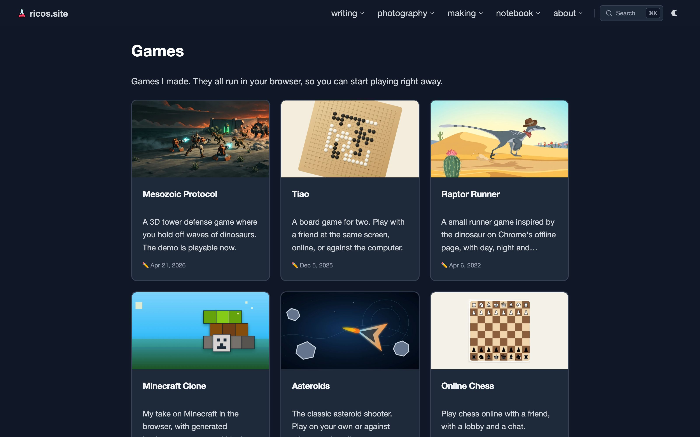
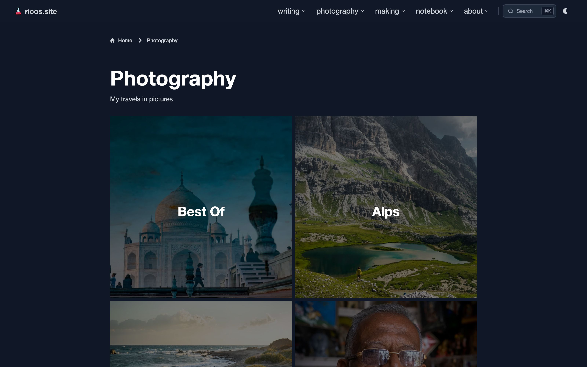

# ricos.site

[](LICENSE)



This repository holds the code of [ricos.site](https://ricos.site), Rico Trebeljahr's personal website. The site carries his essays, booknotes, travel stories, photography and the Live and Learn newsletter.

It also hosts interactive pieces you can use in the browser. "How computers work" starts at a single on/off switch, with circuit demos you can edit. The 3D section has React Three Fiber scenes with shaders, particles and grass.

Read the site at **[ricos.site](https://ricos.site)**, or start with the [guided tour](https://ricos.site/start-here). The code is open under the AGPL, so you can see how any page or demo works.

## What's on the site

| | |
| --- | --- |
|  |  |
|  |  |

- **Writing:** [essays](https://ricos.site/posts), [booknotes](https://ricos.site/booknotes), [travel stories](https://ricos.site/travel), [quotes](https://ricos.site/quotes) and the [Live and Learn](https://ricos.site/newsletters) archive.
- **Photography:** [galleries](https://ricos.site/photography) from Rico's travels.
- **How computers work:** [an interactive series](https://ricos.site/computer) with circuit demos, from one switch to a full adder and a chip you can zoom into.
- **3D demos:** [React Three Fiber scenes](https://ricos.site/r3f).
- **Projects:** [the hub](https://ricos.site/projects) for Rico's games, tools and experiments. Most of them have their own sites and repositories.

## About

Thoughts of a curious person. In Rico's words:

> This is also the home of my blog which will cover a wide array of topics as broad as my curiosity, things like: personal development, nutrition, the workings of computers, brains, cells, economy, programming, music, traveling or photography.
>
> I want to commit to writing for this blog, every day of the week, every week, publishing something whenever I feel it is ready. That is the whole goal of this exercise.
>
> This site should also serve as an artifact, that shows who I am and what I am doing. To showcase what I think and read. It should aggregate my learnigns and life lessons in a digestable form and help me organize my thoughts and serve as a reminder to myself. Of what I want to do and where I want to go. Furthermore it might one day be a valuable resource to other people besides myself.
>
> But that would be an added benefit not the main goal behind creating it.

## Run it locally

You need Node.js 24 or newer and pnpm.

```bash
git clone --recurse-submodules https://github.com/trebeljahr/ricos.site.git
cd ricos.site
pnpm install
cp .env.example .env.local   # Stripe links and newsletter settings, all optional
pnpm dev                     # http://localhost:2222, or set PORT
```

The posts, booknotes and other notes live in `src/content/Notes`, a private Git submodule. A clone without access to it has the code, but not that content.

| Command | What it does |
| --- | --- |
| `pnpm dev` | Next.js dev server, plus watchers for assets and the Velite content index |
| `pnpm build` | Production build. Afterwards it writes the sitemap, RSS feed, search index and backlinks, then checks internal links and image alt text |
| `pnpm test` | Vitest |
| `pnpm typecheck` | TypeScript |
| `pnpm lint` | Biome |

Donations use Stripe Payment Links. Their setup is in [docs/stripe-donations.md](docs/stripe-donations.md).

## Project structure

```
src/pages/        routes (Next.js Pages Router), among them computer/ and r3f/
src/components/   React components; computer/ holds the circuit demos
src/lib/          helpers; computer/ is the circuit simulator the demos share
src/content/      content data; Notes/ is the private notes submodule
src/scripts/      build, import and maintenance scripts, run with tsx
public/           static files, 3D assets and sprites
docs/             developer notes and the marketing images
```

## Tech stack

- Next.js 16 (Pages Router), React 19, TypeScript
- Tailwind CSS 4
- Velite and MDX for the Markdown content
- Three.js with React Three Fiber, drei and Rapier for the 3D pages
- Vitest and Biome
- Hosted on Vercel behind Cloudflare. Images come from S3 through CloudFront.
- Plausible for aggregate visit counts, Listmonk with Amazon SES for the newsletter

## License

The code is licensed under the [GNU AGPL-3.0-or-later](LICENSE).

The licence covers code only. Rico's writing, photos and images are © Rico Trebeljahr, all rights reserved. Third-party assets keep their own licences, for example [public/sprites/LICENSE.txt](public/sprites/LICENSE.txt), [public/images/computer/coins/LICENSE.md](public/images/computer/coins/LICENSE.md) and [public/donate/sources/credits.txt](public/donate/sources/credits.txt).

## Support

You can support the site at [ricos.site/donate](https://ricos.site/donate).
